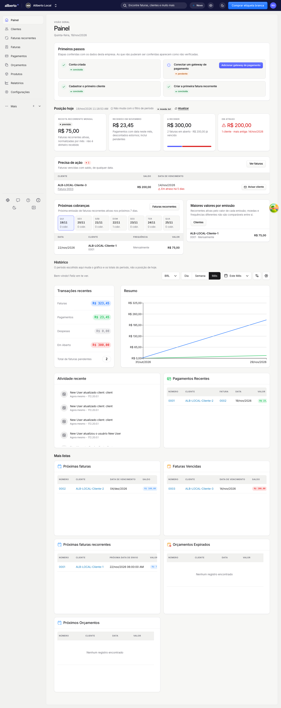

# Backend real local — evidência selecionada

Captura de 19/11/2026 do frontend Allberto em `127.0.0.1:3100`, conectado ao Invoice Ninja 5.13.49 em Docker local. Dados descartáveis, sem interceptação de respostas de negócio. Inspecionada pelo Astra e pelo coordenador.

O painel mostra MRR de R$ 75,00, recebido de R$ 23,45, a receber de R$ 300,00, vencido de R$ 200,00 e uma próxima cobrança em 22/11. O gateway permanece pendente porque não foi configurado. Empresa e clientes usam Brasil/BRL/pt_BR.

O smoke de navegador terminou naturalmente com exit 0: 150 respostas API, zero erros JavaScript, falhas de requisição ou HTTP >=400. Incluiu autenticação, quatro listas, detalhes, edição de cliente salva e conferida por GET, valores financeiros, calendário e recarga autenticada. API e persistência foram conferidas também após reinício do Compose.

Os relatórios completos e o PDF permanecem em `local-backend/evidence/`, ignorado pelo Git. Nenhuma credencial, token, log bruto, trace autenticado ou chave de invitation foi incluído nesta seleção. Resultados e limites: [handoff Astra](../../handoffs/astra-backend-local.md).
